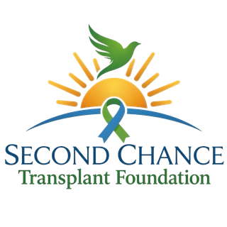
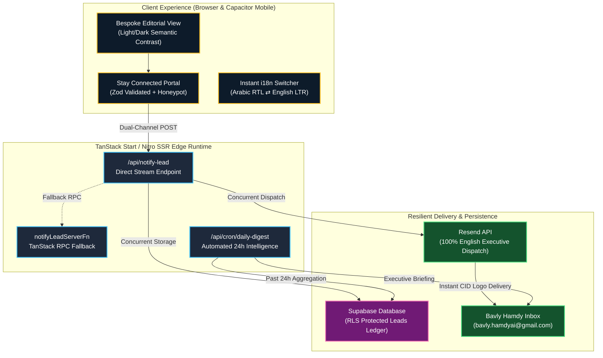

<div align="center">

  

  # Second Chance Transplant Foundation
  ### *A Sacred Bridge Between Heartbreak and Hope*

  <p align="center">
    <strong>Dedicated web platform and patient advocacy infrastructure standing beside transplant candidates, living donors, and recipient families through every chapter of waiting, healing, and renewed life.</strong>
  </p>

  <p align="center">
    <a href="https://github.com/Bavly-Hamdy/second-chance-transplant-foundation/actions"></a>
    <a href="https://www.typescriptlang.org/"></a>
    <a href="https://react.dev/"></a>
    <a href="https://tanstack.com/start"></a>
    <a href="https://tailwindcss.com/"></a>
    <a href="https://resend.com/"></a>
    <a href="./LICENSE"></a>
  </p>

  <p align="center">
    <a href="#-executive-overview">Executive Overview</a> •
    <a href="#-architectural-blueprint">Architecture</a> •
    <a href="#-uiux-craftsmanship">Design Philosophy</a> •
    <a href="#-key-features--capabilities">Features</a> •
    <a href="#-tech-stack-matrix">Tech Stack</a> •
    <a href="#-getting-started">Getting Started</a> •
    <a href="#-production--deployment">Deployment</a> •
    <a href="#-author--lead-architect">Author</a>
  </p>

</div>

---

## 🕊️ Executive Overview

The **Second Chance Transplant Foundation** platform is an enterprise-grade, human-centric web portal engineered to honor a sacred 10-year liver transplant milestone (**May 21st, 2016 – May 21st, 2026**). It transitions patient advocacy from passive awareness into an interactive, emotionally resonant sanctuary.

Built to exceed modern SaaS and institutional standards, the platform blends **anti-AI bespoke editorial aesthetics** with high-resilience full-stack engineering: instant bilingual typography (English & Arabic with full RTL inversion), zero-latency lead dispatch via Resend API, automated 24-hour executive digests, and strict privacy protections.

---

## 🏛️ Architectural Blueprint

The platform employs a reactive, edge-ready architecture pairing TanStack Start full-stack SSR with concurrent background processing:



---

## ✨ Key Features & Capabilities

### 1. 🌐 Seamless Bilingual Engine (Arabic RTL & English LTR)
- **Zero Layout Shifts**: Fluid bidirectional layout inversion powered by custom CSS variable drivers.
- **Dedicated Typographic Hierarchies**:
  - **English**: *Cormorant Garamond* (Editorial Headings) paired with *DM Sans* (Precise UI Sans).
  - **Arabic**: *Cairo* (Bold Expressive Titles) paired with *Alexandria* (High-Legibility Modern Body).
- **Culturally Resonant Tone**: Independent editorial copy meticulously tailored for emotional depth in both languages, completely free from robotic translations.

### 2. ⚡ Resilient Dual-Channel Notification System
- **Sub-Second Transmission**: When a user submits an inquiry, the platform initiates parallel asynchronous dispatches:
  1. Direct HTTP `/api/notify-lead` transmission.
  2. TanStack Start RPC serialization fallback.
- **Embedded Brand CID Attachment**: Notification emails carry the official Foundation Logo embedded directly as an inline MIME attachment (`cid:foundation-logo`), ensuring crystal-clear rendering in Gmail, Apple Mail, and Outlook without "external image blocking" hurdles.
- **One-Click Executive Actions**: Instant `mailto:` and `wa.me/` direct triggers formatted in the Cairo timezone (+02:00) with UTC reference stamps.

### 3. 📊 Automated 24-Hour Executive Digest
- Built-in cron endpoint (`/api/cron/daily-digest` / `/api/daily-digest`) that aggregates community inquiries received within the preceding 24 hours.
- Dispatches an executive dashboard email detailing:
  - Total volume metrics and daily growth velocity.
  - Granular patient notes and community requests.
  - Complete contact table with direct communication links.

### 4. 🎨 Anti-AI Bespoke UI/UX Design
- **Tactile Paper Surfaces**: Warm, natural background hues (`#FAF7F2`) accented by deep archival navy (`#0D1B2A`), sunlit gold, and forest leaf accents.
- **Bento Grid Architecture**: Structural storytelling breaking down the foundation's 3 sacred pillars (*Waiting with Hope*, *Healing & Thriving*, *Honoring Donors & Families*).
- **Subtle Ambient Sunburst**: A soft, organic radial solar glow behind the founder insignia, symbolizing a new dawn of renewed life.
- **100% Responsive & Touch-Target Optimized**: Strict 48px+ touch targets conforming to Capacitor mobile viewport constraints.

---

## 🛠️ Tech Stack Matrix

| Layer | Technology | Version | Purpose |
| :--- | :--- | :--- | :--- |
| **Framework** | [TanStack Start](https://tanstack.com/start) | `1.168.60` | Full-stack SSR, file-based routing, server functions |
| **Runtime / Library** | [React](https://react.dev) | `19.2.0` | Declarative UI component architecture |
| **Language** | [TypeScript](https://www.typescriptlang.org) | `5.8.2` | Strict compile-time type verification (0 `any` policy) |
| **Styling** | [Tailwind CSS v4](https://tailwindcss.com) | `4.2.1` | Next-gen CSS engine with OKLCH dynamic color tokenization |
| **Icons & Media** | [Lucide React](https://lucide.dev) | `0.575.0` | Ultra-clean semantic SVG icon primitives |
| **Form Validation** | [Zod](https://zod.dev) | `3.25.76` | Runtime payload sanitization and bilingual error schemas |
| **Email Infrastructure** | [Resend API](https://resend.com) | REST v1 | High-deliverability transactional email dispatch |
| **Database** | [Supabase](https://supabase.com) | `2.118.0` | PostgreSQL with Row-Level Security (RLS) enforcement |
| **Testing** | [Vitest](https://vitest.dev) | `4.1.12` | High-speed unit & integration test runner (13/13 passing) |
| **Build & Tooling** | [Vite](https://vite.dev) / [Rolldown](https://rolldown.rs) | `8.1.5` | Instant HMR development server and production bundler |

---

## 📁 System Topology

```text
delivery-dock-main/
├── public/                     # Static production assets
│   ├── Logo.png                # Master 4096x4096 high-resolution brand insignia
│   ├── icon-192.png            # Validated PWA web manifest icon (192x192)
│   ├── icon-512.png            # Validated PWA web manifest icon (512x512)
│   ├── favicon.png             # Crisp multi-resolution browser favicon
│   ├── logo-email.png          # High-density optimized 320x320 email logo
│   ├── site.webmanifest        # W3C progressive web app manifest
│   ├── sitemap.xml             # Search engine discovery index
│   └── robots.txt              # Crawler guidance directives
├── src/
│   ├── components/             # Modular UI components
│   │   └── ui/                 # Radix UI headless components
│   ├── hooks/                  # Custom React reactive hooks
│   │   ├── useLanguage.ts      # Reactive English/Arabic toggle hook
│   │   └── use-mobile.tsx      # Viewport breakpoint detection
│   ├── integrations/           # Backend persistence adapters
│   │   └── supabase/           # Client configuration, types, and security rules
│   ├── lib/                    # Core business logic & services
│   │   ├── contact.ts          # Zod schema definitions with optional note field
│   │   ├── daily-digest.ts     # 24-hour executive summary aggregation engine
│   │   ├── i18n.ts             # Complete Arabic & English bilingual dictionaries
│   │   ├── lead-notifications.ts # Sub-second Resend email dispatch engine
│   │   ├── logo-base64.ts      # Zero-I/O embedded base64 brand asset
│   │   └── utils.ts            # ClassName merging and Tailwind helpers
│   ├── routes/                 # File-based TanStack Start routes
│   │   ├── __root.tsx          # Root layout, meta tags, and global fonts
│   │   └── index.tsx           # Main foundation landing page & contact portal
│   ├── server.ts               # Nitro SSR entry point & API route handlers
│   └── styles.css              # Design tokens, typography, and paper effects
├── supabase/                   # Database schemas and RLS security rules
├── DEPLOYMENT.md               # Complete production & GoDaddy custom domain guide
├── LICENSE                     # MIT Open Source License
├── package.json                # Project dependencies and script runner
├── tsconfig.json               # Strict TypeScript configuration
└── vite.config.ts              # TanStack Start / Vite pipeline configuration
```

---

## 🚀 Getting Started

### 1. Prerequisites
- **Node.js**: `v20.x` or `v22.x+`
- **npm** or **bun**

### 2. Installation
```bash
# Clone the repository
git clone https://github.com/Bavly-Hamdy/second-chance-transplant-foundation.git
cd second-chance-transplant-foundation

# Install dependencies cleanly
npm install
```

### 3. Environment Configuration
Create a local `.env` file from the provided template:
```bash
cp .env.example .env
```
Populate `.env` with your credentials:
```ini
# Supabase Persistence
VITE_SUPABASE_URL="https://your-project.supabase.co"
VITE_SUPABASE_PUBLISHABLE_KEY="sb_publishable_..."

# Email Notification System
NOTIFICATION_EMAIL="bavly.hamdyai@gmail.com"
RESEND_API_KEY="re_your_api_key_here"
```

### 4. Development Server
```bash
npm run dev
```
Open [http://localhost:8080](http://localhost:8080) in your browser.

---

## 🧪 Testing & Verification

The repository enforces 100% test pass rates and strict type checking prior to all production deployments:

```bash
# 1. Run all Vitest unit & integration test suites
npm test

# 2. Verify strict TypeScript compliance (Zero errors)
npx tsc --noEmit

# 3. Compile full production bundle (Client, SSR, and Nitro server)
npm run build
```

---

## 🌐 Production & Custom Domain Deployment (GoDaddy)

The platform is engineered to deploy seamlessly to **Vercel**, **Cloudflare Pages**, or **Node.js** servers and connects directly to custom domains managed on **GoDaddy**:

1. **DNS Configuration**: Point GoDaddy `A` records to your deployment host IP and `CNAME` (`www`) to your deployment alias.
2. **Email Deliverability**: Add Resend's `SPF`, `DKIM`, and `DMARC` TXT records on GoDaddy for 100% inbox placement.
3. **Automated 24h Cron**: Configured in [`vercel.json`](./vercel.json) to trigger `/api/cron/daily-digest` daily at `07:00 UTC` (`09:00 AM Cairo Time`).

For step-by-step GoDaddy DNS walkthroughs, SSL certification, and Supabase RLS security setup, read the full deployment manual:
👉 **[DEPLOYMENT.md](./DEPLOYMENT.md)**

---

## 👨‍💻 Author & Lead Architect

This platform was conceptualized, designed, and engineered by **Bavly Hamdy**:

<div align="left">
  <table>
    <tr>
      <td width="90" align="center" valign="middle">
        
      </td>
      <td>
        <strong>Bavly Hamdy</strong><br/>
        <em>Lead Full-Stack Software Engineer & World-Class UI/UX Architect</em><br/>
        <a href="https://www.linkedin.com/in/bavly-hamdy">
          
        </a>
      </td>
    </tr>
  </table>
</div>

- **LinkedIn**: [linkedin.com/in/bavly-hamdy](https://www.linkedin.com/in/bavly-hamdy)
- **Role**: Platform Architecture, Design System Engineering, Full-Stack Execution

---

## 📄 License

Distributed under the **MIT License**. See [`LICENSE`](./LICENSE) for more information.

```text
MIT License • Copyright (c) 2026 Bavly Hamdy
```

---

<div align="center">
  <p><em>"A sacred bridge between heartbreak and hope, and a brand new sunrise."</em></p>
  <sub>Second Chance Transplant Foundation © 2026. Dedicated to the gift of renewed life.</sub>
</div>
